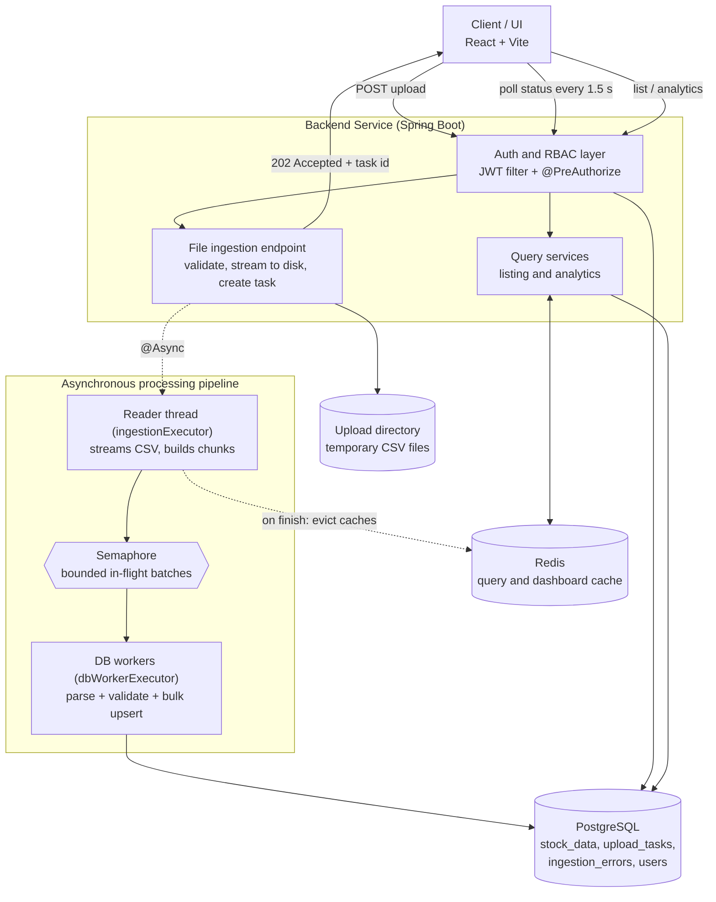

# Market Ledger — Large-Volume CSV Data Ingestion Platform

A full-stack application that ingests large CSV files through an API, processes them asynchronously with streaming, chunking and batched upserts, and presents the data through a filterable table and an analytics dashboard. Access is controlled with JWT authentication and role-based access control (RBAC).

| Layer | Technology |
|---|---|
| Backend | Java 17+, Spring Boot 3, Spring Security (JWT), Spring Data JPA + `JdbcTemplate`, OpenCSV |
| Database | PostgreSQL |
| Cache | Redis (Spring Cache) |
| Frontend | React (Vite), React Router, Tailwind CSS, Axios, Recharts |
| Packaging | Docker, Docker Compose |

---

## Table of contents

1. [Repository layout](#1-repository-layout)
2. [Quick start](#2-quick-start)
3. [Default credentials and roles](#3-default-credentials-and-roles)
4. [Configuration](#4-configuration)
5. [Architecture](#5-architecture)
6. [Ingestion pipeline in detail](#6-ingestion-pipeline-in-detail)
7. [API reference](#7-api-reference)
8. [Frontend](#8-frontend)
9. [Database schema and indexing strategy](#9-database-schema-and-indexing-strategy)
10. [Design decisions and trade-offs](#10-design-decisions-and-trade-offs)
11. [Scaling bottlenecks and next steps](#11-scaling-bottlenecks-and-next-steps)
12. [Benchmarks](#12-benchmarks)
13. [Dataset](#13-dataset)
14. [Known limitations](#14-known-limitations)

---

## 1. Repository layout

```
complete-data-ingestion-platform/
├── .github/                     # CI workflows
├── data-ingestion-platform/     # Backend (Spring Boot)
│   └── src/main/java/com/checkin/ingestion/
│       ├── auth/                # login / logout, UserDetailsService
│       ├── common/              # JwtService, AdminUserSeeder, RestPage, exceptions
│       ├── config/              # Security, CORS, Async executors, Redis cache
│       ├── files/               # upload endpoint, UploadTask entity, TaskService
│       ├── filters/             # JwtAuthenticationFilter
│       ├── settings/            # system settings CRUD
│       ├── stock/               # StockData entity, listing, analytics, ingestion errors
│       ├── user/                # user management
│       └── worker/              # IngestionWorker, CsvBatchProcessor, BatchWriter, CsvRowParser
├── stock-ui/                    # Frontend (React + Vite)
│   └── src/
│       ├── api.js  auth.jsx  hooks.js  App.jsx
│       ├── components/          # Layout, ui primitives
│       └── pages/               # Login, Dashboard, StockList, Upload, IngestionErrors, Users
├── docker-compose.yml           # Brings up the full stack
└── .env                         # Environment variables used by docker-compose
```

---

## 2. Quick start

### Prerequisites

- Docker 24+ and Docker Compose v2

### Run everything with one command

```bash
git clone <your-repo-url>
cd complete-data-ingestion-platform

# 1. Review / edit the environment file (see section 4)
cp .env   # optional: keep a private copy

# 2. Build and start backend, frontend, database and Redis
docker compose up --build
```

When the containers are healthy:

| Service | Default URL |
|---|---|
| Frontend | `http://localhost:3000` (or `5173` if you run the Vite dev server) |
| Backend API | `http://localhost:1997` |

Open the frontend, sign in with the admin account from [section 3](#3-default-credentials-and-roles), go to **Upload CSV**, and drop in a dataset file.

> Check `docker-compose.yml` for the exact published ports. The ports above are the application defaults (`SERVER_PORT=1997`) and the origins allowed by CORS (`3000`, `5173`).

### Run without Docker (development)

**Backend**

```bash
cd data-ingestion-platform

# Option A: H2 file database, no external services needed for the DB
#   (uses application-local1.properties)
./mvnw spring-boot:run -Dspring-boot.run.profiles=local1

# Option B: PostgreSQL + Redis
export SPRING_DATASOURCE_URL="jdbc:postgresql://localhost:5432/ingestion?reWriteBatchedInserts=true"
export SPRING_DATASOURCE_USERNAME=postgres
export SPRING_DATASOURCE_PASSWORD=postgres
export SPRING_DATA_REDIS_HOST=localhost
./mvnw spring-boot:run
```

Redis is required in both options because the Spring cache is backed by it.

**Frontend**

```bash
cd stock-ui
npm install
# Point the UI at the backend (omit if you proxy /api through Vite or nginx)
echo "VITE_API_BASE=http://localhost:1997" > .env.local
npm run dev
```

---

## 3. Default credentials and roles

| Role | Email | Password | How it is created |
|---|---|---|---|
| **ADMIN** | `admin@gmail.com` | `Admin@12345` | Seeded automatically on first start by `AdminUserSeeder` (skipped if the email already exists) |
| **VIEWER** | — | — | Create one as Admin: **Users → Add user → role VIEWER** (suggested: `viewer@gmail.com`) |

Change the admin account before any shared deployment by setting `FIRST_ADMIN_EMAIL` and `FIRST_ADMIN_PASSWORD`.

### Permissions

| Capability | Admin | Viewer |
|---|:---:|:---:|
| Sign in, view dashboard | ✅ | ✅ |
| View / filter / sort stock data | ✅ | ✅ |
| Upload CSV files | ✅ | ❌ |
| View upload history and live progress | ✅ | ❌ |
| View ingestion errors | ✅ | ❌ |
| Manage users (create, change role, enable/disable, delete) | ✅ | ❌ |
| System settings API | ✅ | ❌ |

Authorization is enforced in two places:

- **API layer:** `@EnableMethodSecurity` with `@PreAuthorize("hasRole('ADMIN')")` or `hasAnyRole('ADMIN','VIEWER')` on every controller method. All routes except `/api/v1/auth/**` and `/actuator/**` require a valid JWT.
- **UI layer:** admin-only navigation links are hidden for viewers, and admin routes are wrapped in a `Protected adminOnly` guard that redirects viewers to the dashboard.

---

## 4. Configuration

All settings live in `application.properties` and can be overridden with environment variables (set them in `.env` for Docker Compose).

### Environment variables

| Variable | Default | Purpose |
|---|---|---|
| `SERVER_PORT` | `1997` | Backend HTTP port |
| `SPRING_DATASOURCE_URL` | PostgreSQL JDBC URL | Database connection. Keep `reWriteBatchedInserts=true` |
| `SPRING_DATASOURCE_USERNAME` | — | Database user |
| `SPRING_DATASOURCE_PASSWORD` | — | Database password |
| `SPRING_DATA_REDIS_HOST` | `localhost` | Redis host |
| `SPRING_DATA_REDIS_PORT` | `6379` | Redis port |
| `JWT_SECRET` | built-in dev key | **Base64** HS256 signing key. Always override outside local dev |
| `CORS_ALLOWED_ORIGINS` | `http://localhost:3000,http://localhost:5173` | Comma-separated list of allowed UI origins |
| `FIRST_ADMIN_EMAIL` | `admin@gmail.com` | Seeded admin email |
| `FIRST_ADMIN_PASSWORD` | `Admin@12345` | Seeded admin password |
| `VITE_API_BASE` | empty (same origin) | Frontend: backend base URL, set at build time |

### Pipeline tuning (`application.properties`)

| Property | Value | Meaning |
|---|---|---|
| `ingestion.batch-size` | `5000` | Rows per DB transaction |
| `ingestion.worker-threads` | `4` | Files processed in parallel (one reader thread per file) |
| `ingestion.db-worker-threads` | `4` | Threads that parse and write batches |
| `ingestion.max-stored-errors` | `500` | Max error rows persisted per upload (the total error count is still exact) |
| `ingestion.upload-dir` | `/data/uploads` | Temporary storage for uploaded files. **Mount a volume here** |
| `spring.servlet.multipart.max-file-size` | `1GB` | Upload size limit |
| `spring.datasource.hikari.maximum-pool-size` | `20` | Must be ≥ `db-worker-threads` plus headroom for API traffic |

Spring's relaxed binding also lets you override these with environment variables, for example `INGESTION_BATCH_SIZE=2000`.

---

## 5. Architecture



### Request flow

1. An admin uploads a CSV with `multipart/form-data`.
2. The API checks the extension, **streams** the upload to disk under a server-generated name (`<uuid>.csv`, so the client file name is never used as a path), inserts an `upload_tasks` row with status `PENDING`, hands the task to the background executor, and immediately returns **`202 Accepted`** with the task id.
3. The UI polls `GET /api/v1/admin/files/{id}` every 1.5 seconds and renders a progress bar.
4. A background reader claims the task (`PENDING → PROCESSING`), streams the file, splits it into batches, and dispatches them to the DB worker pool.
5. When the last batch commits, the task becomes `COMPLETED` (or `FAILED`), the temporary file is deleted, and the Redis caches are evicted so the dashboard and table reflect the new data.

---

## 6. Ingestion pipeline in detail

### Streaming and chunking

- The upload is copied from the request stream to disk with `Files.copy`, which uses a small buffer, so memory use does not depend on file size.
- The reader uses **OpenCSV's `CSVReader`** over a 64 KB buffered `InputStreamReader`. Rows are read one at a time and collected into batches of `ingestion.batch-size` rows. The file is never loaded into memory.
- Before processing starts, a fast raw byte scan counts newline characters to estimate `totalRows` so the progress bar has a denominator. After processing, `totalRows` is replaced with the exact processed count (the estimate can be off when quoted fields contain line breaks).

### Backpressure and bounded memory

`IngestionWorker` limits in-flight batches with a **semaphore** of size `max(2, dbWorkerThreads × 2)`. When all workers are busy the reader blocks instead of buffering more of the file, so peak memory is roughly `in-flight batches × batch size` rows, regardless of file size.

### Two thread pools

| Pool | Threads | Role |
|---|---|---|
| `ingestionExecutor` | `ingestion.worker-threads` (4), queue 50 | One thread per file: reads and chunks the CSV |
| `dbWorkerExecutor` | `ingestion.db-worker-threads` (4), queue 64 | Parses/validates rows and writes batches. Fixed size so it never exceeds the connection pool |

If the ingestion queue is full, the upload is rejected with `503 Service Unavailable` and the task is marked `FAILED`.

### Batched upserts

`BatchWriter` writes each batch in **one transaction** using `JdbcTemplate.batchUpdate` with PostgreSQL's `INSERT ... ON CONFLICT (ticker, trade_date) DO UPDATE`, combined with the `reWriteBatchedInserts=true` driver option, which collapses the batch into multi-row inserts.

- **Last row wins.** Within a batch, rows are put in a `TreeMap` keyed by `(ticker, trade_date)`, which de-duplicates them (last occurrence wins) and sorts them. Across batches, the `WHERE` guard on the upsert (`upload_task_id IS DISTINCT FROM ... OR row_num < ...`) keeps the later row in the file even if two batches race.
- **Deadlock avoidance.** Sorting by `(ticker, date)` makes concurrent batches take row locks in the same order. Progress is *not* updated inside the data transaction (that used to serialize all workers on a single `upload_tasks` row). It is a tiny auto-commit `processed_rows = processed_rows + delta` statement after the batch commits, so it can never move backwards when workers finish out of order.
- **Lock retries.** Deadlocks, lock timeouts and serialization failures are retried up to 3 times with randomized backoff.

### Validation and resilience

`CsvRowParser` validates every row. A bad row is **recorded and skipped, and never aborts the batch or the file**.

| Check | Behaviour |
|---|---|
| Header mapping | Case-insensitive with aliases (`symbol` / `ticker`, `trade_date` / `date`, `adj close` / `adj_close`, ...). Missing `ticker`, `date` or `close` fails the task with a clear message |
| Ticker | Required, ≤ 20 characters, normalized to upper case |
| Date | `yyyy-MM-dd`, `yyyy-MM-dd HH:mm:ss`, or US `M/d/yyyy` |
| Numbers | Must parse as decimals; thousands separators are stripped; negative values rejected |
| Business rule | `high` must not be less than `low`; `close` required |
| Blank lines | Skipped silently |
| Duplicates | Resolved by upsert (see above) |
| Database rejects a row | The batch is **binary-split** and retried to isolate the offending rows, costing about *k·log₂(n)* transactions for *k* bad rows instead of *n*. Only the bad rows are recorded as errors |
| Database unavailable | Not treated as a bad row: the task is marked `FAILED` instead of recording every row as rejected |
| A batch fails permanently | The reader stops, waits for running batches, and fails the task with a message |

Rejected rows are stored in `ingestion_errors` (row number, raw row, reason), capped at 500 per upload while `error_count` stays exact. Admins browse them in the UI.

### Status model

`PENDING → PROCESSING → COMPLETED | FAILED`, with `totalRows`, `processedRows`, `errorCount`, `errorMessage`, and `createdAt` / `startedAt` / `finishedAt` timestamps. The claim step is an atomic `UPDATE ... WHERE status = 'PENDING'`, so a task can never be processed twice.

---

## 7. API reference

All endpoints except login require `Authorization: Bearer <jwt>`. Pagination and sorting use Spring's `page`, `size` and repeated `sort=field,dir` parameters (for example `sort=ticker,asc&sort=tradeDate,desc` for multi-column sorting).

### Authentication

| Method | Path | Access | Description |
|---|---|---|---|
| POST | `/api/v1/auth/login` | Public | Body `{email, password}` → `{token, type, email, role}` (token valid 24 h) |
| POST | `/api/v1/auth/logout` | Public | Stateless; the client discards the token |

### Files and ingestion (Admin)

| Method | Path | Description |
|---|---|---|
| POST | `/api/v1/admin/files/upload` | Multipart field `file` (`.csv`, up to 1 GB). Returns `202` with the task |
| GET | `/api/v1/admin/files/{id}` | **Status / progress** of one task |
| GET | `/api/v1/admin/files` | Paginated upload history, newest first |
| GET | `/api/v1/admin/ingestion-errors/tasks/{taskId}` | Paginated rejected rows for a task |

Status response:

```json
{
  "id": "6f1c...",
  "fileName": "sp500.csv",
  "status": "PROCESSING",
  "totalRows": 1000000,
  "processedRows": 420000,
  "errorCount": 17,
  "errorMessage": null,
  "createdAt": "2026-11-10T10:00:00",
  "startedAt": "2026-11-10T10:00:01",
  "finishedAt": null
}
```

### Stock data and analytics (Admin and Viewer)

| Method | Path | Description |
|---|---|---|
| GET | `/api/v1/stocks` | Paginated, sortable, filterable listing |
| GET | `/api/v1/stocks/analytics` | Dashboard aggregates. Params: `ticker`, `startDate`, `endDate` |

Listing filters: `ticker`, `startDate`, `endDate`, `minClosePrice`, `maxClosePrice`, `minAdjClosePrice`, `maxAdjClosePrice`, `minVolume`, `maxVolume`, `minDividends`, `hasDividends`, `minStockSplits`, `hasStockSplits`, `uploadTaskId`.

### User management and settings (Admin)

| Method | Path | Description |
|---|---|---|
| POST / GET | `/api/v1/admin/users` | Create user / list users |
| GET / PUT / DELETE | `/api/v1/admin/users/{id}` | Read / update email / delete |
| PATCH | `/api/v1/admin/users/{id}/role` | Body `{role: "ADMIN" \| "VIEWER"}` |
| PATCH | `/api/v1/admin/users/{id}/status` | Body `{enabled: true \| false}` |
| POST / GET | `/api/v1/admin/system-settings` | Create / list settings |
| GET / PUT / DELETE | `/api/v1/admin/system-settings/{key}` | Read / update / delete a setting |

Spring Boot Actuator exposes `/actuator/health`, `/actuator/info` and `/actuator/metrics`.

---

## 8. Frontend

| Page | Route | Role | Description |
|---|---|---|---|
| Login | `/login` | Public | Email/password sign-in |
| Dashboard | `/` | Admin, Viewer | KPIs and charts with ticker and date-range filters |
| Stock data | `/stocks` | Admin, Viewer | Server-side paginated table |
| Upload CSV | `/upload` | Admin | Drag-and-drop upload, upload progress, live processing progress, history |
| Ingestion errors | `/errors`, `/errors/:taskId` | Admin | Pick an upload, then browse its rejected rows |
| Users | `/users` | Admin | Create users, change roles, enable/disable, delete |

### Dashboard metrics and charts

Every filter change re-aggregates on the server.

| Visual | Metric |
|---|---|
| KPI cards | Row count, distinct tickers, average close, total dollar volume (close × volume), anomaly-day count |
| Line chart | Close price with **20- and 50-period moving averages**, bucketed by day / week / month so the chart stays under about 400 points |
| Horizontal bar chart | Top 10 tickers by dollar volume (click a bar to focus that ticker) |
| Gainers / losers | Top 5 and bottom 5 by change in adjusted close over the range (when no ticker is selected) |
| Anomaly table | Days where return or volume is more than **3 standard deviations** from that ticker's own mean: price move, volume spike, or both |

### Data table features

- Server-side pagination (10–100 rows per page)
- Multi-column sorting: click a header to cycle asc → desc → off, **Shift/Ctrl-click** to add more sort columns
- Search by ticker with a **400 ms debounce**
- Filters: date range, close / adjusted close / volume ranges, minimum dividends, "has dividends", "has splits"
- Responsive layout with a mobile sort picker

### Session handling

The JWT and role are kept in `localStorage`. An Axios interceptor attaches the bearer token and, on any `401` (except login), clears the session and redirects to `/login`.

---

## 9. Database schema and indexing strategy

Schema is generated by Hibernate (`ddl-auto=update`). Flyway is configured but disabled and has no migrations yet.

### Tables

**`users`**

| Column | Type | Notes |
|---|---|---|
| `id` | UUID | PK |
| `email` | varchar(150) | Unique, not null |
| `password_hash` | varchar | BCrypt |
| `role` | varchar(20) | `ADMIN` / `VIEWER` |
| `enabled` | boolean | Disabled users cannot sign in |
| `created_at` | timestamp | |

**`upload_tasks`**

| Column | Type | Notes |
|---|---|---|
| `id` | UUID | PK, also the temp file name |
| `file_name` | varchar(255) | Sanitized display name |
| `file_path` | varchar | Server-side temp path |
| `uploaded_by` | UUID | From the JWT `uuid` claim |
| `status` | varchar(20) | `PENDING`, `PROCESSING`, `COMPLETED`, `FAILED` |
| `total_rows`, `processed_rows`, `error_count` | bigint | Progress counters |
| `error_message` | varchar | Failure reason |
| `created_at`, `started_at`, `finished_at` | timestamp | |

**`stock_data`**

| Column | Type | Notes |
|---|---|---|
| `id` | bigint | PK, identity |
| `row_num` | bigint | Row number in the source file |
| `ticker` | varchar(20) | Upper-cased |
| `trade_date` | date | |
| `open_price`, `high_price`, `low_price`, `close_price`, `adj_close_price` | numeric(19,4) | |
| `volume` | bigint | |
| `dividends`, `stock_splits` | numeric(19,4) | |
| `upload_task_id` | UUID | Which upload last wrote the row |

**`ingestion_errors`**: `id`, `task_id`, `row_num`, `raw_row`, `reason`

**`system_settings`**: `id` (key, varchar(100), PK), `value` (int), `updated_by` (UUID), `updated_at`

### Indexes

| Table | Index | Why |
|---|---|---|
| `stock_data` | **Unique `(ticker, trade_date)`** | The upsert conflict target (idempotent re-uploads). Its leading column also serves ticker lookups and ticker + date-range queries |
| `stock_data` | `(trade_date)` | Date-range filters and the dashboard's date-only aggregates |
| `stock_data` | `(upload_task_id)` | "Show the rows from this upload" |
| `stock_data` | `(close_price)` | Price-threshold filters and sorting |
| `ingestion_errors` | `(task_id)` | Fetching errors for one upload |
| `users` | unique `(email)` plus `(email, id)` | Login lookup |

**Trade-off:** each index slows bulk writes. The index set is deliberately small. Volume, dividends and the other numeric columns are not indexed, so filtering or sorting on them scans the table; see the scaling notes below.

---

## 10. Design decisions and trade-offs

| Decision | Why | Trade-off |
|---|---|---|
| **In-process thread pools** instead of an external message queue | Simplest way to meet the async requirement; no extra moving parts; backpressure via semaphore | Work is not durable: a crash mid-ingest leaves a task in `PROCESSING`, and you cannot scale workers independently of the API |
| **Upload to disk, then process** | The request returns immediately; the worker re-reads the file; a failed run is easy to reason about | Needs local disk and a persistent volume; with several API instances the file must live on shared storage |
| **JDBC batch upsert**, not JPA `saveAll` | Hibernate entity management is far slower for millions of rows; native `ON CONFLICT` gives idempotent loads | SQL is PostgreSQL-specific (an H2 `MERGE` variant is kept in comments) |
| **Sort + de-duplicate each batch** | Prevents "cannot affect row a second time" errors and cuts deadlocks | Small CPU cost per batch |
| **Binary-split error isolation** | A single bad row does not discard 4,999 good ones, and recovery is cheap | A pathological file with many DB-level rejects costs more transactions |
| **Progress as delta updates outside the data transaction** | Removes a hot-row lock that serialized workers | Progress can briefly be ahead of or behind a committing batch |
| **Polling** for status (1.5 s) instead of SSE/WebSocket | Trivial, proxy-friendly, stateless | Slight delay and repeated requests; SSE would be the next step |
| **JWT, stateless sessions** | No session store; fits horizontally scaled APIs | No server-side revocation (see limitations) |
| **Redis cache** for listing (10 min TTL) and dashboard (5 min TTL), evicted after each ingestion | Dashboard aggregates are expensive and the data changes only on upload | Results can be stale until the next eviction or TTL; keys include all filters so cache cardinality can grow |
| **Group daily series in the service** (day/week/month) rather than SQL `date_trunc` | The same SQL runs on PostgreSQL and H2 | Pulls one row per day into memory (bounded by trading days) |
| **Anomaly detection with z-scores** (|z| > 3) on adjusted return and volume | Simple, explainable, needs no ML | Uses each ticker's full history; sensitive to outliers |

---

## 11. Scaling bottlenecks and next steps

1. **Single node, in-memory queue.** For multiple API replicas or crash recovery, move chunk dispatch to a durable broker (Kafka, RabbitMQ, SQS, or a Redis stream) with separate worker containers. Persist batch ranges so a restarted worker can resume instead of restarting the file. On startup, re-queue tasks left in `PROCESSING`.
2. **Database write throughput.** Gains come from tuning `batch-size`, worker count and `maximum-pool-size` together (the Postgres connection count is the ceiling). Beyond that, load via `COPY` into a staging table followed by a single `INSERT ... ON CONFLICT ... SELECT`, drop secondary indexes during very large loads, and partition `stock_data` by date range.
3. **Deep pagination.** `OFFSET`-based paging and the per-page `COUNT(*)` slow down on tens of millions of rows. Move to keyset (cursor) pagination and an approximate count for unfiltered views.
4. **Dashboard queries.** Anomaly detection runs window functions over every ticker's full history. Pre-compute into materialized views or summary tables refreshed after each ingestion, and use a read replica for analytics.
5. **Cache granularity.** `evictAll` clears everything after each upload. Version cache keys by a "data version" counter instead.
6. **Local file storage.** Use object storage (S3/GCS) with multipart upload and resumable chunked uploads from the browser so an interrupted transfer can resume.
7. **Progress delivery.** Replace polling with SSE or WebSockets when the number of concurrent viewers grows.

---

## 12. Benchmarks

The worker logs one summary line per task, which is the source for the figures below:

```
Task <uuid> COMPLETED: <rows> rows, <errors> errors, <ms> ms, <rows/sec> rows/sec
```

**Fill in with your own run** before submitting:

| Run | File size | Rows | Batch size | Reader / DB threads | Duration | Rows/sec | Errors |
|---|---|---|---|---|---|---|---|
| 1 | _MB_ | _ | 5,000 | 4 / 4 | _s_ | _ | _ |
| 2 | _MB_ | _ | 5,000 | 4 / 8 | _s_ | _ | _ |
| 3 | _MB_ | _ | 2,000 | 4 / 4 | _s_ | _ | _ |

Record alongside the table: machine (CPU/RAM), PostgreSQL location (local container vs managed cloud: network latency strongly affects batch throughput), and whether the table was empty or being upserted over existing rows.

**How to reproduce**

```bash
# 1. Get a token
TOKEN=$(curl -s -X POST http://localhost:1997/api/v1/auth/login \
  -H 'Content-Type: application/json' \
  -d '{"email":"admin@gmail.com","password":"Admin@12345"}' | jq -r .token)

# 2. Upload
curl -s -X POST http://localhost:1997/api/v1/admin/files/upload \
  -H "Authorization: Bearer $TOKEN" -F "file=@sp500.csv"

# 3. Poll progress (use the id from step 2)
curl -s http://localhost:1997/api/v1/admin/files/<id> -H "Authorization: Bearer $TOKEN" | jq
```

---

## 13. Dataset

1. S&P 500 US Stock Market Data: <https://www.kaggle.com/datasets/parsalatifi/s-and-p-500-us-stock-market-data>

**This implementation targets dataset 1 (S&P 500 stock prices).** The parser and schema are specific to price-history columns:

| Field | Accepted CSV headers |
|---|---|
| ticker (required) | `ticker`, `symbol`, `stock`, `name` |
| date (required) | `date`, `trade_date`, `timestamp`, `datetime` |
| open / high / low | `open`, `high`, `low` |
| close (required) | `close`, `close_price`, `price` |
| volume | `volume`, `vol` |
| adjusted close | `adj_close`, `adjclose`, `adjusted_close`, `adj_close_price` |
| dividends | `dividends`, `dividend`, `div` |
| stock splits | `stock_splits`, `stocksplits`, `split`, `splits` |

Files from datasets 2 and 3 will be rejected with a "Missing required column" error. Supporting them would require a separate entity, parser and dashboard queries (or a schema-mapping layer; see next steps).

---

# Market-Ledger

